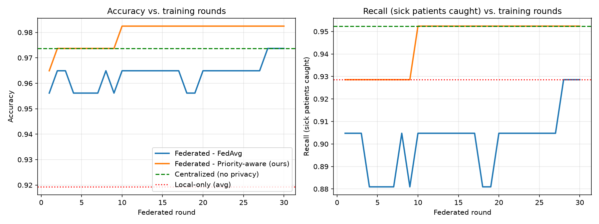

# FedCare: Federated Learning for Privacy-Preserving Disease Prediction

A beginner-friendly simulation of **federated learning** for disease prediction, built for a Fog and Edge Computing course project. Several simulated hospitals each train a model on their own private patient data. Only the model weights (a list of numbers) are shared and averaged, so raw patient data never leaves a hospital.

> **Student project, not a medical tool.** Never use it to make decisions about anyone's health.

## What it does

Compares four ways of training the same disease-prediction model on 5 simulated hospitals with different patient mixes (non-IID data):

| Method | Privacy | Idea |
|---|---|---|
| A. Centralized | No | All data in one place (benchmark) |
| B. Local-only | Yes | Each hospital trains alone |
| C1. Federated, FedAvg | Yes | Hospitals share weights, never data |
| C2. Federated, priority-aware | Yes | **Novelty:** hospitals with a higher share of sick patients get more weight in the average |

Results from one run (seed 42):

| Method | Accuracy | Recall |
|---|---|---|
| Centralized | 0.974 | 0.952 |
| Local-only (average) | 0.919 | 0.929 |
| Federated, FedAvg | 0.974 | 0.929 |
| Federated, priority-aware | 0.982 | 0.952 |

Honest note: averaged over 20 random seeds, the priority-aware gain in recall is small (about 1 percentage point: 0.956 vs 0.945) and was never worse than FedAvg. The test set has only 114 patients, so treat differences of 1-2% as within noise.



## Files

| File | Purpose |
|---|---|
| `fedcare.py` | The whole simulation: data split, local training, aggregation, comparison, graph |
| `webapp.py` | Small local web page: enter 30 measurements and get a prediction |
| `data/breast_cancer_wisconsin_diagnostic.csv` | The dataset (see credit below) |
| `requirements.txt` | Python libraries needed |
| `GUIDE.md` | Step-by-step beginner guide |
| `DATASET_AND_EXPLANATION.md` | Dataset details and a detailed explanation of the method |

## How to run

1. Install Python 3.9 or newer.
2. Install the libraries:
   ```
   pip install -r requirements.txt
   ```
3. Run the simulation (creates `fedcare_results.png`):
   ```
   python fedcare.py
   ```
4. Run the web demo, then open http://127.0.0.1:8000 if it does not open by itself:
   ```
   python webapp.py
   ```

On Mac/Linux use `python3` and `pip3`.

To use the included CSV instead of the built-in copy, set these two lines near the top of `fedcare.py`:
```python
CSV_PATH = "data/breast_cancer_wisconsin_diagnostic.csv"
CSV_TARGET = "diagnosis_malignant"
```

## Limitations

- One disease and one small dataset, split artificially into "hospitals".
- Simple model (logistic regression).
- No formal privacy guarantee: weights can still leak a little information, and real systems add secure aggregation or differential privacy.
- The priority score shares one extra number per hospital (its share of sick patients).

## Dataset credit

Wolberg, W., Mangasarian, O., Street, N., & Street, W. (1993). *Breast Cancer Wisconsin (Diagnostic)* [Dataset]. UCI Machine Learning Repository. https://doi.org/10.24432/C5DW2B. Licensed under [CC BY 4.0](https://creativecommons.org/licenses/by/4.0/).
